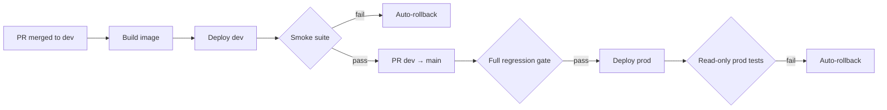

# Mohammad Saqib Manan

**Senior SDET & DevOps Engineer** · Test Automation · CI/CD · Cloud · CivicDataLab · Delhi, India

*I build the test systems that catch bugs before users do, and the deploy pipelines that refuse to ship them.*

---

## About

I have 5+ years in quality engineering, across AI platforms, civic-data infrastructure and digital banking. At **CivicDataLab** I own quality and delivery end to end for three production platforms, one of them under the IndiaAI Mission. The test frameworks are mine, and so are the CI/CD pipelines that run them and the deploy gates that use their results.

I treat QA as engineering. A test that can't fail isn't a test. A deploy that can't roll itself back isn't finished. I don't call a bug "flaky" until I have evidence.

**Focus areas:** Test Automation · Quality Engineering · Shift-Left & Continuous Testing · CI/CD · DevOps · Release Engineering · AWS Cloud · Infrastructure as Code · Observability · Agentic AI & LLM tooling

---

## By the Numbers

| | |
|---|---|
| **3** | production test frameworks I designed and built from scratch: Playwright and Selenium, Python-first |
| **5** | test layers in one repo for ParakhAI: E2E, accessibility, visual regression, API, performance |
| **732** | tests in the ParakhAI suite, run in parallel across 2 user roles for full-platform sign-off |
| **7** | services I put on automated, test-gated CD (most with automatic rollback) |
| **110** | WCAG 2.1 AA checks in the CivicDataSpace accessibility suite (48 real failures surfaced) |
| **~1,140** | commits across product, test and infra repos in Jul–Sep 2026 |

---

## Quality Engineering

| Platform | What it is | Framework |
|---|---|---|
| [**ParakhAI**](https://github.com/CivicDataLab/ParakhAI_test) | IndiaAI Mission platform for participatory algorithmic auditing | Playwright + pytest, 5 test layers, Keycloak SSO multi-user fixtures |
| [**IDS-DRR**](https://github.com/CivicDataLab/IDS-DRR-QA-Automation) | Disaster-risk analytics across 5 Indian states | Selenium with self-healing locators, YAML-driven multi-state tests, sharded CI |
| [**CivicDataSpace**](https://github.com/CivicDataLab/CivicDataSpace-test) | Open civic-data exchange (datasets, AI models, use cases) | Selenium POM for consumer and provider journeys, GraphQL API tests, PDF/MD reports |

<b>ParakhAI: five test layers in one repo</b>

- **E2E**: Playwright + pytest, organised in three layers: `tests/` holds assertions only, `pages/` holds page objects, `locators/` holds raw selectors
- **Accessibility**: axe-core against WCAG 2.1 AA on every key page, with third-party violations tracked separately
- **Visual regression**: pixel-diff baselines on desktop, tablet and mobile viewports
- **API**: GraphQL through a shared, session-cached auth client
- **Performance**: Chrome DevTools Protocol and Navigation Timing (load time, TTFB, LCP, throttled 3G)
- **Sandbox-gated write tests**: these skip unless a sandbox org is configured, so production data can't be changed by accident
- **Test-data tooling**: seed, bulk cleanup and gated hard-reset scripts, all built on the same GraphQL client
- **Bug ledger**: every skip or `xfail` links to a numbered product bug with repro steps and GraphQL-level evidence

<b>IDS-DRR: self-healing and data-driven</b>

- **Self-healing locators**: if a locator fails, the framework falls back through other strategies, and locators that work are saved to `learned_locators.json` for next time
- **Multi-state by config**: there is one YAML file per state. Adding a state means adding a file, with no code change
- **State auto-discovery**: a script crawls a live deployment and generates the state's config
- **Sharded CI**: `pytest-split` × `pytest-xdist`, capped at the concurrency where the dev server starts falling over
- **Cross-repo triggers**: every frontend deploy fires `repository_dispatch`, which runs smoke tests on dev and the full suite on prod
- **Beyond functional tests**: accessibility, performance, load, security and responsive suites, plus a 15-minute availability probe that files an incident when an upstream service goes down

<b>CivicDataSpace: breadth and reporting</b>

- 11 numbered provider smoke flows, from login to collaborative creation, for both individual and organisation paths
- Test-data factories with timestamped, varchar-aware values, so tests can run in parallel across several test accounts
- REST and GraphQL API tests, enum-parity checks against codegen, search-after-publish consistency tests
- Report pipeline: per-suite JSON → merged report → Markdown and styled PDF with failure screenshots
- `pending_pr` marker: a test written against an open PR skips until that PR merges, so coverage can land before the code does without turning CI red

---

## Delivery & Platform

I've owned deployments and platform operations since January 2026. Every product follows the same rule: **dev gets every test, prod only gets read-only tests, and any failure rolls back on its own.**

| Service | How it ships |
|---|---|
| DataSpace backend | AWS ECS + CloudFormation, explicit migration task, smoke gate, auto-rollback, commit-SHA traceability |
| DataSpace frontend | Releases/symlink deploys, health-check rollback, smoke gate |
| ParakhAI frontend + API | Build, deploy, smoke dispatch, auto-rollback, `/health/` and `/health/ready/` probes |
| IDS-DRR | GHCR images over SSH, smoke-gated, auto-rollback |
| Analytics (Superset) | AWS SSM-based deploys with GitHub OIDC, dev and prod legs, test coverage |
| Keycloak theme | Containerised, GHCR build, staging → prod from `main`, scheduled auth tests |

I also run a 59-URL health monitor across current and legacy projects, and I upgraded Keycloak (24 → 26.7) and moved it to a new domain, with test coverage on both products.

<b>Root-cause stories</b>

- **P0 database pool exhaustion.** CI had been polluted by it for weeks. I watched `pg_stat_activity` live during a CI run and found the cause: a dev `runserver` serving production-shaped load. I moved it to supervised gunicorn to match the prod config, and added an idle-session timeout and Sentry.
- **A blank dashboard with every health signal green.** When the backend moved to images, the uploaded-media mount was quietly dropped, leaving 2,000+ files invisible. Health checks passed, but users would have seen an empty dashboard. Smoke tests now check content as well as status codes.
- **75 CI "failures" that were noise.** The cause was concurrency against a shared dev backend, not product bugs. I serialised the suites and set a concurrency cap, which saved the team a full false-alarm triage cycle.
- **CI that passed without testing anything.** Some runs skipped everything and still reported a pass. Other tests sat inside string literals and never ran. I turned silent skips into failures and brought the hidden tests back, so a green CI result now means the tests ran and passed.

---

## Agentic AI Engineering

I run **Claude Code as an autonomous engineering agent**, not as a chat window. It works from a per-repo `CLAUDE.md`, plans before it acts, splits exploration across subagents, triages bugs with evidence, and records a lesson after every correction.

- **pr-test-sync**: after a product PR merges, it reads the diff, writes matching tests in the right test repo, checks that they can actually fail, and opens a draft PR
- **board-card**: turns finished or planned work into a correctly placed GitHub issue on the right project board and sprint, with every field set. It ships as a Claude Code plugin
- **gh-sprint-planner**: a generic GitHub Projects v2 tool that creates sprints, fills them, and rolls them up across boards
- **Second Brain**: a deterministic knowledge index over my workspace. It answers the same lookups in **0.46s** that took the default approach **226s and 577k tokens**
- **[gopub](https://github.com/saqibmanan/gopub)**: a pre-flight check before making a private repo public. It scans the working tree and the full git history for secrets, weak defaults and forbidden files
- **Playwright MCP**: lets agents explore the live UI and generate tests from it

---

## Engineering Principles

1. **Prod gets read-only tests.** Write-side tests run against dev and sandboxes only.
2. **A test must be able to fail.** Before a new test ships, I prove it catches the bug it was written for.
3. **Every skip has a ticket.** No unexplained `skip` or `xfail` stays in the suite.
4. **Deploys verify and revert themselves.** A health check that only returns 200 doesn't count as verification.
5. **Evidence before verdict.** I check the data, the logs and the load before calling something a product bug or a flake.
6. **Write it down.** Runbooks belong in the repo. They shouldn't live only in my head.

---

## Currently Learning

| Area | Goal |
|---|---|
| **Terraform** | Move from CloudFormation to Terraform, one infra slice at a time |
| **Kubernetes · Helm · EKS** | Migrate services off EC2 + Compose onto EKS |
| **OpenTelemetry → APM → Kibana** | Turn on the observability stack, define SLIs/SLOs, add alerting |
| **k6** | Performance baselines for critical flows, run in CI |
| **OWASP security testing** | Automated security checks in CI |

---

## Tech Stack

**Test Automation**

**CI/CD & DevOps**

**Testing Specialisms**

- API & GraphQL contract testing
- Accessibility (WCAG 2.1 AA)
- Visual regression
- Mobile-responsive web automation
- Performance testing & load testing

**AI-Assisted QA**

- Claude Code · Codex · Playwright MCP as autonomous test-generation agents

---

## Experience

**Quality Assurance Engineer (SDET & DevOps)** · CivicDataLab · Jun 2023 – Present · Delhi, India

- Sole quality engineer across three production platforms, owning the full QA and DevOps stack
- Built five-layer Playwright + pytest framework for ParakhAI (IndiaAI Mission)
- Engineered self-healing Selenium suite for IDS-DRR, auto-triggered on every frontend deploy
- QA-adjacent DevOps: GitHub Actions, Docker, AWS (EC2/S3/RDS/ECR), Nginx

**System Engineer — QA** · Tata Consultancy Services · Jul 2021 – May 2023 · India

- Tested Citibank's digital banking platform in an Agile delivery model
- Functional, regression, and integration testing for high-availability financial features

---

## Beyond the Code

- 🎤 **Represented CivicDataLab at India AI Summit 2026**
- 🎪 **Organised CivicSabha 2** — International Conference on Data for Public Good, Feb 2026
- 🎪 **Organised ParakhAI Workshop** — Participatory Algorithmic Auditing, Delhi 2025
- 🏔️ **Organised Institutional Development Index and Data Management Workshop** — McLeodganj, 2025
- 🌍 **Represented CivicDataLab at WSDS** (World Sustainable Development Summit), Delhi 2024
- 🎪 **Organised CivicSabha 1** — International Conference on Data for Public Good, Delhi 2023

---

## Education

**B.Tech, Electronics & Communication Engineering**
Shri Mata Vaishno Devi University (SMVDU) · 2017 – 2021

---

  <i>Open to Senior SDET / QA Automation roles where automation, CI/CD, and AI-assisted tooling actually matter.</i>  
  <i>DMs open · saqibmanan6@gmail.com</i>

